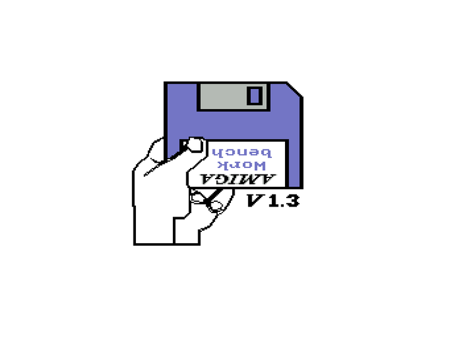
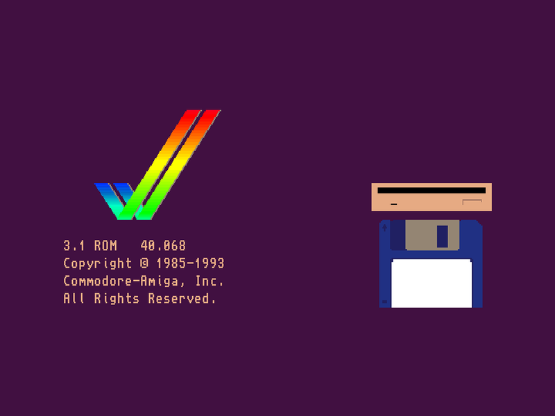
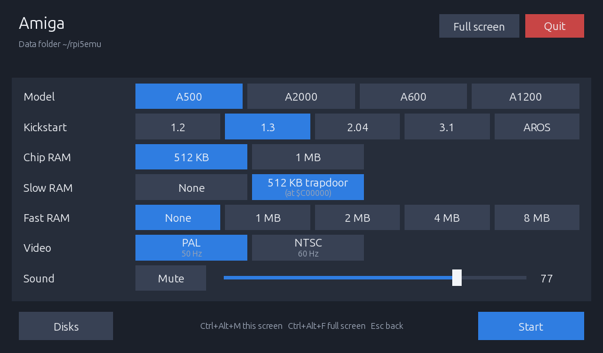
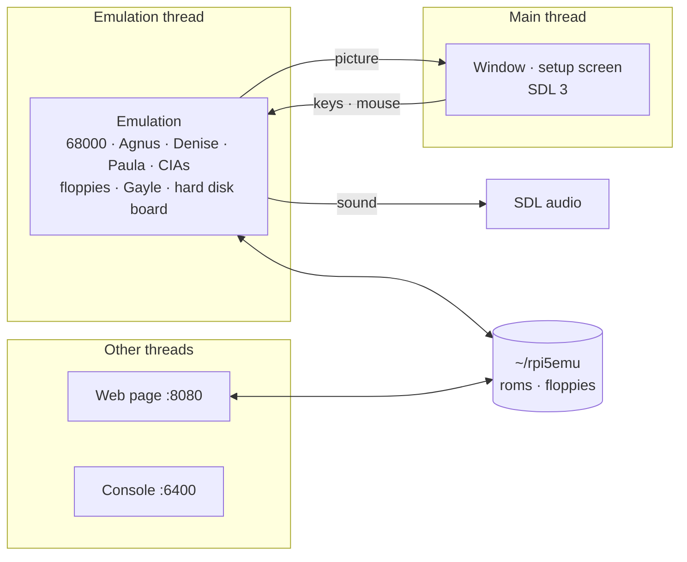

<h1 align="center">rpi5ami</h1>

<p align="center">
  <b>A Commodore Amiga 500, 2000, 600 or 1200 on the Raspberry Pi 5, in a window of its own.</b><br>
  A 68000 at 7.09 MHz with the OCS and ECS chipsets (Agnus, Denise, Paula, two 8520 CIAs), or the A1200's 68EC020 with AGA (Alice, Lisa), Kickstart 1.2 to 3.1 or the free AROS, floppy and hard disk images, the A600's IDE port, fast RAM.
</p>

<p align="center">
  
  
  
  
  
</p>

<p align="center">
  <b>Work in progress:</b> not everything has been tested, and games and demos may or may not
  work satisfactorily.
</p>

<p align="center">
  
  
  <br>
  <sub>Kickstart 1.3 on the A500 and Kickstart 3.1 on the A1200 (AGA, 68EC020), on the Pi.</sub>
</p>

rpi5ami runs [esp32ami](https://github.com/rlucencic/esp32ami)'s Amiga on a Raspberry Pi 5 with
64-bit Linux, in a window of its own (X11 or Wayland, through SDL 3). The machine is the
same code as on the ESP32 boards: esp32ami's platform-independent core and
[esp32emu](https://github.com/rlucencic/esp32emu)'s CPU core, on
[rpi5emu](https://github.com/rlucencic/rpi5emu), the family's Linux runtime: a setup
screen in the window, sound, the Pi's keyboard and mouse, a web page on your network and a
console.

It's one of the rpi5 family, the Raspberry Pi versions of the esp32 emulators:
[rpi5zx](https://github.com/rlucencic/rpi5zx) (ZX Spectrum),
[rpi5cpc](https://github.com/rlucencic/rpi5cpc) (Amstrad CPC),
[rpi5cbm](https://github.com/rlucencic/rpi5cbm) (Commodore 64 and 128),
[rpi5coco](https://github.com/rlucencic/rpi5coco) (Tandy Color Computer 2 and 3),
[rpi5gs](https://github.com/rlucencic/rpi5gs) (Apple IIGS),
[rpi5msx](https://github.com/rlucencic/rpi5msx) (MSX1 and MSX2),
[rpi5xl](https://github.com/rlucencic/rpi5xl) (Atari 800XL and 130XE),
[rpi5ste](https://github.com/rlucencic/rpi5ste) (Atari STE),
[rpi5pc](https://github.com/rlucencic/rpi5pc) (IBM PC/XT and PC/AT),
[rpi5mac](https://github.com/rlucencic/rpi5mac) (Macintosh Plus, SE, Classic),
[rpi5mac2](https://github.com/rlucencic/rpi5mac2) (Macintosh LC and II),
[rpi5mac3](https://github.com/rlucencic/rpi5mac3) (Macintosh LC II and LC III),
[rpi5arc](https://github.com/rlucencic/rpi5arc) (Acorn Archimedes).

## Features

**The machine**
- **68000** at 7.09 MHz (7.16 MHz in NTSC), timed on the Amiga's chip bus:
  its memory accesses fall on the bus's slots and wait for the chips' DMA,
  except when it runs from fast RAM or the ROM. SysInfo and xSysInfo
  measure 1.00 times an A600 in chip RAM and a B2000 in fast RAM
- **68EC020** at 14.19 MHz for the A1200 with its 256-byte instruction
  cache, waiting for the chip bus on each access to chip RAM and the
  chips: SysInfo measures 1.04 times an A1200 and 14.6 MHz
- **Agnus**: the DMA slots of every line, the **copper** (its waits to the
  line and the position), the **blitter** (area and line modes, fill), the
  bitplane and sprite DMA; ECS's bigger chip RAM, the display window's high
  bits and BEAMCON0's PAL/NTSC switch
- **Denise**: lores and hires, one to six bitplanes, dual playfield, extra
  half-brite, HAM, the eight sprites (attached pairs too), collisions;
  **interlace** with both fields woven into one picture; ECS
  **super-hires** (Workbench's 1280 x 256 and 1280 x 512), the 1280
  columns shown whole
- **AGA** (the A1200's Alice and Lisa): 256 colours from 16.8 million, up
  to 8 bitplanes in any resolution, 32 and 64-bit fetches, HAM8, the
  sprites 16 to 64 pixels wide and their colour banks; the A1200 games of
  Amiga Forever's collection show their AGA pictures
- **Paula**: four sound channels with the A500's filters (and the power
  LED's) and the attach modes, disk DMA with the sync word at any bit, the interrupts
- **Two 8520 CIAs**: timers, the time-of-day counters, the keyboard's
  serial handshake; the **battery-backed clock**, set from the Pi's time
- **Expansion**: autoconfig fast RAM (1 to 8 MB, Zorro II), the A600's and A1200's
  **Gayle** IDE port, and a hard disk board of this project's own (a boot
  ROM and a driver) for Kickstart 1.3 and 2.04, which have no IDE driver
- **Kickstart 1.2, 1.3, 2.04, 2.05 and 3.1**, the A1200's **3.0 and 3.1**, or **AROS** with its
  extension ROM; Kickstart 3.1's Early Startup Control (both mouse buttons
  at power-on) works, NTSC toggle included
- **PAL or NTSC**, the picture following the beam's standard
- **In real time** on the Pi with plenty of room (the A1200's insert-disk
  screen: the emulation about 5% of a core)

**Disks**
- **Two floppy drives** (DF0:, DF1:): `.adf` images read and written,
  AmigaDOS disks turning faster than a real drive and the others (custom
  loaders) at a real drive's pace; UAE's extended ADFs (raw tracks of
  copy-protected disks), read and written
- **Amiga Forever's `.rp9` game packages**: the manifest read, the disks
  unpacked and inserted; putting the package in again gives its next disk
- **Two hard disks** (DH0:, DH1:): `.hdf` images with an RDB or a bare
  partition, through Gayle (Kickstart 2.05, 3.1, AROS) or this project's
  board (1.3, 2.04: its FFS loaded from the disk). Amiga Forever's games
  with a hard disk are joined with its system disk (`workbench-135.hdf`)
  and boot as one
- **New blank disks**: 880 KB floppies, 20, 50 or 100 MB hard disks ready
  for the Amiga's own Format
- **DMS archives and gzipped images** (`.dms`, `.adz`, `.hdz`) dropped onto
  the web page are unpacked in the browser
- **Free space** on each disk and **free chip, slow and fast RAM**, as the
  Amiga counts them, on the web page

**Around it**
- **A window** of its own on the Pi's desktop (X11 or Wayland), resizable, full screen
  with Ctrl+Alt+F; the picture in the machine's shape, smoothly scaled
- **Setup screen** in the window, first thing at start and any time with Ctrl+Alt+M:
  model, Kickstart, chip, slow and fast RAM, video, the sound's volume, the drives and their images (insert, eject, new
  blank ones), Start / Back / Restart, Reset
- **The Pi's keyboard and mouse**: keys by position, as the boards' Bluetooth keyboards;
  a click in the window gives the mouse to the machine, Ctrl+Alt+G takes it back
- **Web page** at `http://<the Pi>:8080/`: drop images (or ZIP files) onto it, insert
  them, make blank ones, and watch the machine and its drives live
- **Sound** through SDL (PipeWire, PulseAudio or ALSA), the machine paced by the clock
- **Console** on the terminal and on `127.0.0.1:6400`: keys, typing, drives, screenshots

<p align="center">
  
  <br><sub>The setup screen in the window, before the Amiga starts</sub>
</p>

## Getting started

### 1. What you need

- A Raspberry Pi 5 with 64-bit Linux (developed on Ubuntu 26.04; any Linux with SDL 3.2 or
  later should do)
- The tools and libraries:
  `sudo apt install build-essential cmake ninja-build pkg-config libsdl3-dev libsdl3-ttf-dev libpng-dev zlib1g-dev`
- [esp32emu](https://github.com/rlucencic/esp32emu), [rpi5emu](https://github.com/rlucencic/rpi5emu)
  and [esp32ami](https://github.com/rlucencic/esp32ami), cloned next to this project
- The ROMs (below)

### 2. Build

```sh
git clone https://github.com/rlucencic/esp32emu.git
git clone https://github.com/rlucencic/rpi5emu.git
git clone https://github.com/rlucencic/esp32ami.git
git clone https://github.com/rlucencic/rpi5ami.git && cd rpi5ami
cmake -S . -B build -G Ninja && cmake --build build
```

### 3. ROMs

Kickstarts in the data folder's `roms/` (`~/rpi5emu/roms`), under any name:
each is found by its version (esp32ami's are FS-UAE's names,
`amiga-os-130.rom` ...). Not part of this repository; AROS's two ROMs are
free.

### 4. First start

1. `build/rpi5ami`: the setup screen opens in a window.
2. Choose the model and click **Start**.
3. Put images into `~/rpi5emu/floppies/`, drop them on the window or the web page, and
   insert them on the setup screen's **Disks** page.

## Using it

| To | Do |
|---|---|
| Get back to the setup screen | Ctrl+Alt+M (the machine waits meanwhile) |
| Full screen | Ctrl+Alt+F |
| Give the mouse to the machine, take it back | A click in the window; Ctrl+Alt+G |
| Run as fast as it goes (warp) | Ctrl+Alt+W, again for real speed |
| Take a screenshot | Ctrl+Alt+S (into `~/rpi5emu/screenshots`), or the console's `s` |
| Insert an image | The setup screen's **Disks** page, drop it on the window or the web page, or name it on the command line: `build/rpi5ami game.adf` |
| Start straight into the machine | `build/rpi5ami -S`, with the setup screen's rows as `--choice`: `build/rpi5ami -S --choice Model=A1200 --choice Kickstart=3.1` |
| Show the window on another computer | Log in with `ssh -C -Y <the Pi>` and start it there: fine for still pictures; games want the Pi's own monitor |
| Use a joystick | F12 makes the cursor keys and the keypad the joystick in port 2, Alt fire |
| Play an Amiga Forever game | Its `.rp9` into DF0: (into DH0: if it has a hard disk); the same package again: its next disk |
| Make a blank disk | Web page: **New blank disk** (880 KB, or a 20, 50 or 100 MB hard disk to format on the Amiga) |

Images live in `~/rpi5emu/floppies/`, settings in `~/.config/rpi5emu/settings.ini`; the
inserted images are remembered across starts. `build/rpi5ami --help` lists the options.

**Keyboard**: by position, as on an Amiga. Help is F11, the Amiga keys are
the Windows/⌘ keys, Caps Lock toggles; the keypad as the Amiga's.

## How it works



- **[esp32ami](https://github.com/rlucencic/esp32ami)'s `components/amiga`**: the Amiga,
  platform independent: the same code runs on the ESP32 boards.
- **`src/`**: the glue, esp32ami's `main/main.c` ported: memory, ROMs, settings, keyboard map,
  drives and status.
- **[rpi5emu](https://github.com/rlucencic/rpi5emu)**: the window, the setup screen, sound,
  input, the web page, the console, the data folder and the settings.
- **[esp32emu](https://github.com/rlucencic/esp32emu)**: the CPU core (68000 · 68EC020).

## Development

```sh
../rpi5emu/tools/pi.sh rpi5ami build        # from another computer: sync to the Pi, build there
../rpi5emu/tools/pi.sh rpi5ami run          # its window on this computer (ssh -C -Y)
../rpi5emu/tools/pi.sh rpi5ami headless     # no window: drive it through the console
../rpi5emu/tools/console.sh i 's /tmp/shot.png'
```

`CLAUDE.md` has the details: the layout, how it was ported, the checks; esp32ami's own
`CLAUDE.md` has the machine's.

## Limitations

- Checked on the Pi through its console and screenshots: the A500 with Kickstart 1.3 and the A1200 with 3.1 at full speed to their insert-disk screens. Not yet by hand
  in the window, with the sound heard, or with much software.
- Over X forwarding (`ssh -Y`) every changed picture crosses the network: 8 to 15 a second.
- The 68000 waits for the chip bus slot by slot (the DMA's even slots
  in each line), but its bus cycles are taken back to back from each
  instruction's start, not where a real 68000 has them: SysInfo and
  xSysInfo give 1.03 and 1.06 times an A600. The blitter gets the slots
  each line's display leaves it, counted a line at a time. Demos that
  count on exact bus cycles may show it.
- No IPF (SPS) images. DMS archives in the
  "quick", "medium", "deep" and "heavy 1" modes are written but untested
  (no such archives at hand).
- No serial or parallel devices, MIDI, or a second mouse.
- What's planned, in order: [TODO.md](https://github.com/rlucencic/esp32ami/blob/main/TODO.md).

## Credits

- The Amiga Hardware Reference Manual and the ROM Kernel Reference Manuals,
  the 8520 data sheet, the MC68000 User's Manual
- [WinUAE](https://www.winuae.net), [FS-UAE](https://fs-uae.net),
  [vAmiga](https://dirkwhoffmann.github.io/vAmiga/), PUAE and Minimig,
  read for how the hardware behaves (not copied)
- Keir Fraser's [Amiga Test Kit](https://github.com/keirf/amiga-stuff)
  (public domain), the hardware tests
- xDMS by Andre Rodrigues de la Rocha (public domain), the reference for
  the DMS modes
- [Musashi](https://github.com/kstenerud/Musashi) by Karl Stenerud, the
  68000 core (MIT, in esp32emu)
- [AROS](https://aros.sourceforge.io), the free Kickstart replacement
- [SDL](https://libsdl.org) 3 for the window, the sound and the input

## Licence

[MIT](LICENSE).

Amiga, Kickstart and Workbench are trademarks of their owners. This project
contains no Commodore code; you need your own ROM images and software (or
AROS's free ROMs).
